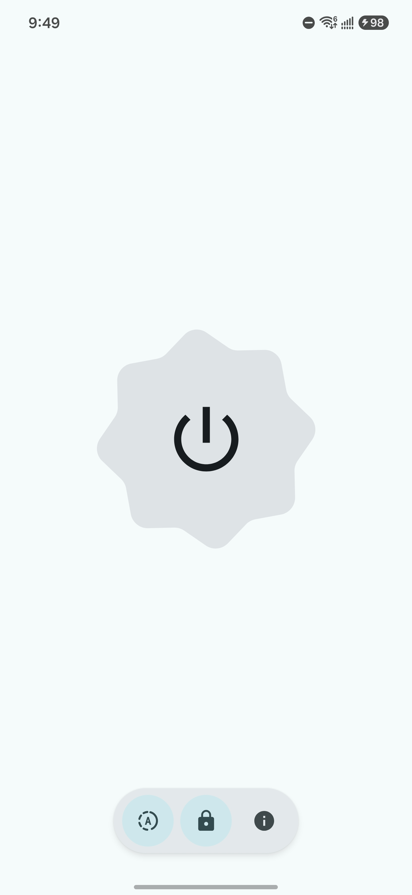
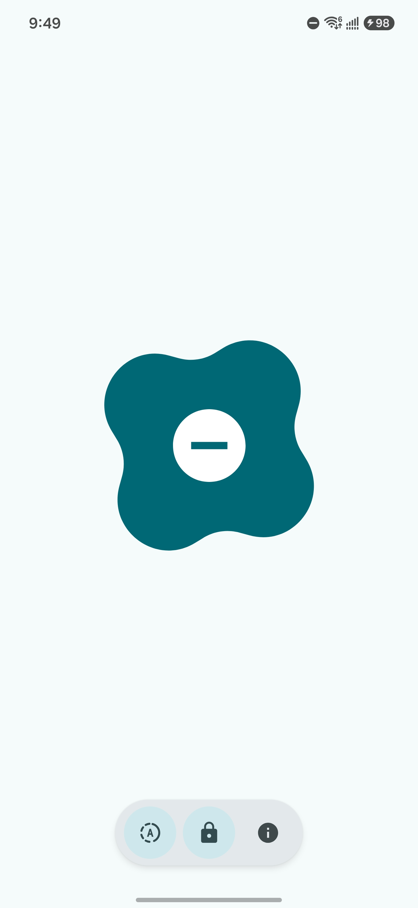
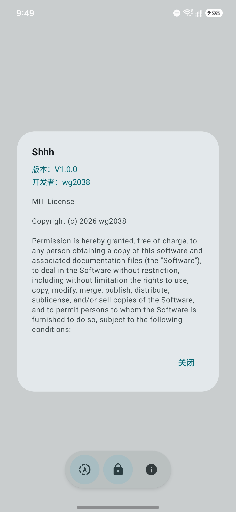

# Shhh

[简体中文](README_zh-CN.md) · English · [繁體中文](README_zh-TW.md)

Flip-to-mute and optional screen lock for Android 13+ devices.

## Screenshots

| Stopped | Listening | About |
| :---: | :---: | :---: |
|  |  |  |

## How it works

Detection runs in a foreground service (`ShhhService`), backed by a pure-Kotlin state machine (`FlipStateMachine`) and a sliding-window stillness check (`StillnessDetector`):

1. **Idle monitoring**: Listens to `TYPE_GRAVITY` (falls back to `TYPE_ACCELEROMETER`) at `SENSOR_DELAY_UI` with 500 ms sensor-hub batching. Proximity stays off while idle to avoid under-display IR blinking.
2. **Face-down confirmation**: Once normalized gravity tilt is within ~15 deg (`cosTilt >= 0.965`), sampling switches to `SENSOR_DELAY_GAME` for 2.0 s (2.5 s without a gyroscope). `StillnessDetector` drops the first 300 ms of landing impact and checks de-meaned 3-axis variance over up to 50 samples to filter out handheld tremor. Optical proximity is checked on demand if present; virtual/ultrasonic proximity sensors skip that gate.
3. **DND and optional lock**: Switches to `INTERRUPTION_FILTER_PRIORITY` only when the system was in `INTERRUPTION_FILTER_ALL`, leaving manual or scheduled DND untouched. If Flip to Lock is enabled, `GLOBAL_ACTION_LOCK_SCREEN` runs 150 ms later so fingerprint and face unlock keep working.
4. **Lift exit**: Exits on >30 deg tilt hysteresis (`cosTilt < 0.866`) or optical proximity `Far` after a 300 ms debounce. Screen-on (`ACTION_SCREEN_ON`) or proximity lift opens a 1 s zero-latency validation window to catch slow pickups without false triggers while still face down.

## Build

Requires JDK 17 and Android SDK 35. Application ID: `io.github.wg2038.shhh` (minSdk 33).

```bash
./gradlew test assembleDebug
```

## License

[MIT](LICENSE)
