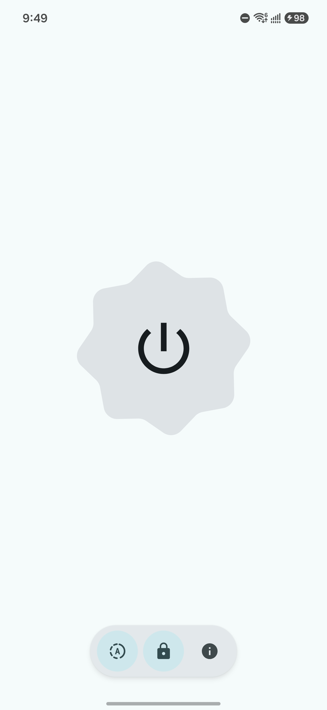
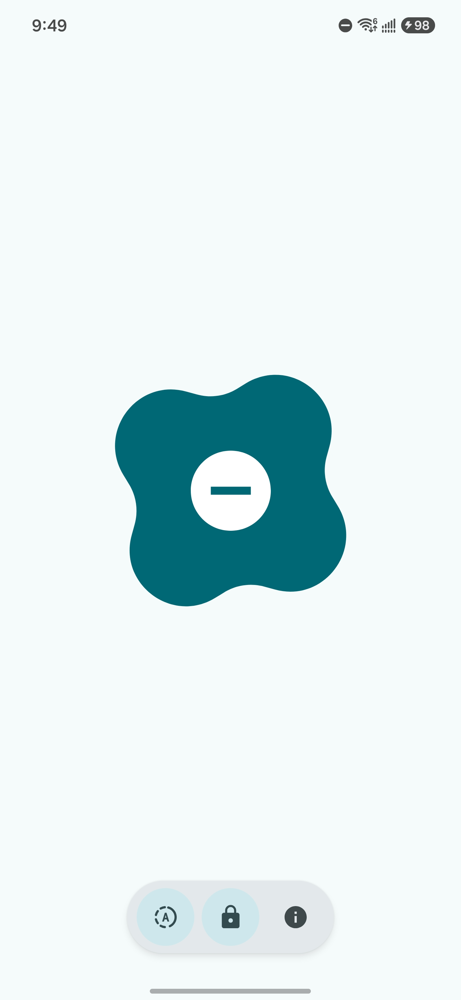
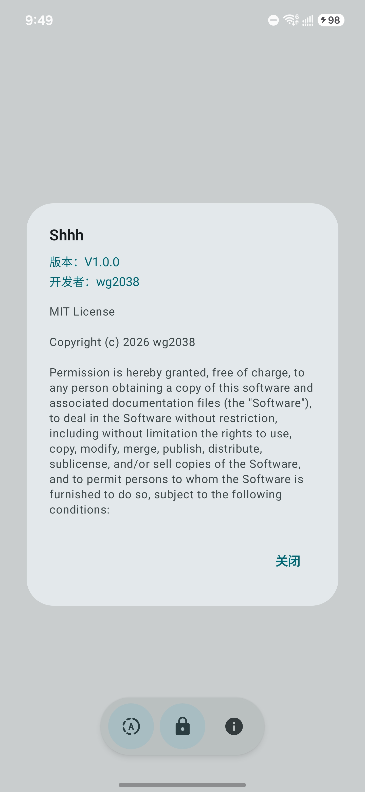

# Shhh

简体中文 · [English](README.md) · [繁體中文](README_zh-TW.md)

让你的 Android 13+ 设备实现翻转静音与熄屏。

## 界面预览

| 未开启 | 监听中 | 关于 |
| :---: | :---: | :---: |
|  |  |  |

## 实现原理

检测逻辑在后台前台服务（`ShhhService`）中运行，核心拆分为无框架的状态机（`FlipStateMachine`）和滑窗静止检测（`StillnessDetector`）：

1. **待机监听**：以 `SENSOR_DELAY_UI` 配合 500 ms 硬件批处理（batching）监听 `TYPE_GRAVITY`（无重力传感器时回退到加速度计）。待机时关闭距离传感器，避免屏下红外频繁闪烁。
2. **扣放确认**：当归一化重力倾角进入约 15° 以内（`cosTilt >= 0.965`），切到 `SENSOR_DELAY_GAME` 开始 2.0 秒倒计时（无陀螺仪为 2.5 秒）。`StillnessDetector` 会丢弃落桌前 300 ms 的冲击样本，对最多 50 帧数据做三轴去均值方差校验，过滤手持晃动。硬件光学距感仅在此阶段按需介入，虚拟/超声波距感机型自动跳过该门控。
3. **开启勿扰与锁屏**：仅在系统原本处于全允许状态（`INTERRUPTION_FILTER_ALL`）时才切换为 `INTERRUPTION_FILTER_PRIORITY`，退出时只还原由本应用开启的勿扰，不干扰手动或定时规则。若开启翻转锁屏，150 ms 后通过无障碍服务触发 `GLOBAL_ACTION_LOCK_SCREEN`，保留指纹与面容解锁。
4. **翻起退出**：采用 30° 倾角滞回（`cosTilt < 0.866`）或光学距感远离作为退出条件，配合 300 ms 防抖。亮屏广播（`ACTION_SCREEN_ON`）或距感脱离会拉起 1 秒零延迟校验窗口，兼顾轻拿轻放与亮屏不误退。

## 构建

需要 JDK 17 与 Android SDK 35，包名 `io.github.wg2038.shhh`（minSdk 33）。

```bash
./gradlew test assembleDebug
```

## 开源协议

[MIT](LICENSE)
