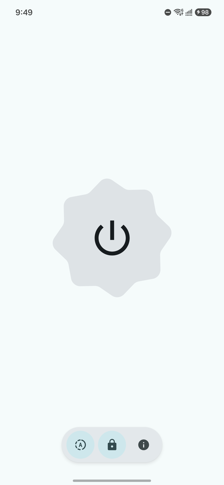
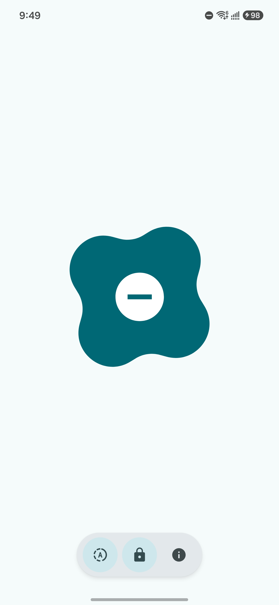
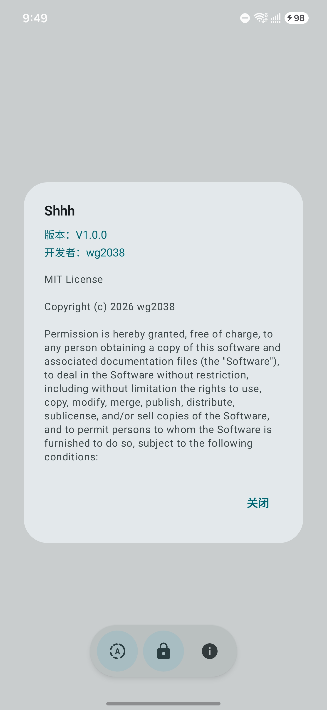

# Shhh

[简体中文](README_zh-CN.md) · [English](README.md) · 繁體中文

讓你的 Android 13+ 裝置實現翻轉靜音與熄屏。

## 介面預覽

| 未開啟 | 監聽中 | 關於 |
| :---: | :---: | :---: |
|  |  |  |

## 實作原理

偵測邏輯於前台服務（`ShhhService`）中執行，核心拆分為無框架的狀態機（`FlipStateMachine`）與滑窗靜止偵測（`StillnessDetector`）：

1. **待機監聽**：以 `SENSOR_DELAY_UI` 搭配 500 ms 硬體批次處理（batching）監聽 `TYPE_GRAVITY`（無重力感測器時回退至加速度計）。待機時關閉距離感測器，避免螢幕下紅外線頻繁閃爍。
2. **朝下確認**：當歸一化重力傾角進入約 15° 以內（`cosTilt >= 0.965`），切換至 `SENSOR_DELAY_GAME` 開始 2.0 秒倒數（無陀螺儀為 2.5 秒）。`StillnessDetector` 會丟棄放桌前 300 ms 的衝擊樣本，對最多 50 幀資料做三軸去均值變異數校驗，過濾手持晃動。硬體光學距感僅於此階段按需介入，虛擬／超音波距感機型自動略過該門控。
3. **開啟勿擾與鎖屏**：僅在系統原本處於全允許狀態（`INTERRUPTION_FILTER_ALL`）時切換為 `INTERRUPTION_FILTER_PRIORITY`，退出時僅還原由本應用開啟的勿擾，不影響手動或排程規則。若開啟翻轉鎖屏，150 ms 後透過無障礙服務呼叫 `GLOBAL_ACTION_LOCK_SCREEN`，保留指紋與臉部解鎖。
4. **翻起退出**：採用 30° 傾角遲滯（`cosTilt < 0.866`）或光學距感遠離作為退出條件，搭配 300 ms 防抖。亮屏廣播（`ACTION_SCREEN_ON`）或距感脫離會開啟 1 秒零延遲校驗視窗，兼顧輕拿輕放與亮屏不誤退。

## 建置

需要 JDK 17 與 Android SDK 35，套件名稱 `io.github.wg2038.shhh`（minSdk 33）。

```bash
./gradlew test assembleDebug
```

## 開源授權

[MIT](LICENSE)
